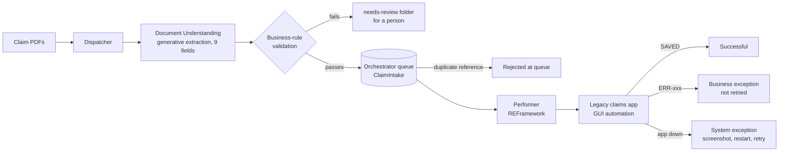

# Claim Intake Bot · UiPath end-to-end demo

A UiPath automation that reads insurance claim forms (PDF) with **Document Understanding**, checks them against business rules, queues valid claims in **Orchestrator**, and enters them into a **legacy claims system** with a **REFramework** robot. No manual keying.

> All data in this repo is synthetic. The insurer, people and claims are invented for testing.

**Demo video (2 min):** _link coming_

---

## The problem

Claim forms arrive as PDFs, and staff key the details into an older claims system by hand. That is slow, error-prone, and delays support for the person who made the claim.

## How it works

**Dispatcher** (`ClaimIntake.Dispatcher`)
1. Reads each claim PDF with **Extract Document Data** (generative extractor, 9 fields described in plain English).
2. Validates every field: required fields present, claim number pattern, DD/MM/YYYY dates, accident date not in the future, date of birth before the accident, numeric invoice amount.
3. Valid claims go to the `ClaimIntake` queue, with the claim number as a **unique reference**. Invalid claims are copied to `needs-review/` with the reason logged.

**Performer** (`ClaimIntake.Performer`, 2026 REFramework)
1. Signs in to the legacy app using an **Orchestrator credential asset**, never a password in code or config.
2. Enters each queued claim, then reads the app's status message to decide the outcome.
3. **Business exceptions** (bad data, duplicates) are marked and not retried. **System exceptions** (app down, element missing) trigger a screenshot, a clean restart of the app, and a queue retry.

## Results

<!-- RESULTS -->
| Measure | Result |
|---|---|
| Extraction accuracy (clean form) | 9 of 9 fields correct |
| Claims entered without manual keying | _pending full run_ |
| Average time per claim (performer) | about 13 seconds |
| Duplicate claim caught | at the queue, before reaching the app |
| Missing-data claim | routed to a person with the reason |
| Simulated outage | recovered automatically, claim retried and saved |

## Design decisions

- **Two layers of duplicate protection.** The queue's unique reference stops duplicates before any robot time is spent; the legacy app's own check is the backstop.
- **Business vs system exceptions.** Bad data goes to a person and is never retried; technical failures are retried after a clean restart. `MaxRetryNumber` stays 0 because retries are owned by the queue.
- **No confidence score from generative extraction.** Generative extractors don't return calibrated confidence, so validation uses business rules instead. Asking the model twice was considered and rejected: it doubles cost and latency for little gain on a fixed-layout form. For a stable, high-volume form in production, a trained extractor with real confidence scores plus sample-based QA would be the next step.
- **Found by deliberately breaking things.** Interfering with the app mid-run exposed a typing failure being misread as bad data (fixed with *Verify execution* on every Type Into) and a browser restart race condition (fixed with a recovery delay).
- **No personal data in logs.** Logs carry the claim number only; names, dates of birth and injuries never appear.
- **Legacy selectors in one place.** The mock app's cryptic field IDs (`f1`–`f9`) are mapped once, so a UI change is a single fix.

## Run it yourself

1. Create a free UiPath Community account and enable **Document Understanding** for your tenant (Admin > Tenants > Services).
2. In Orchestrator's **Shared** folder, create the queue `ClaimIntake` (unique references on, 2 retries) and the assets `LegacyApp_Credential` (`demo` / `demo123`) and `LegacyApp_Path` (full path to `mock-legacy-app/claims.html`).
3. Run `ClaimIntake.Dispatcher` (PDFs into the queue), then `ClaimIntake.Performer` (queue into the legacy app).
4. To test recovery, tick **Simulate system outage** in the mock app's yellow test panel mid-run.

## Repo layout

| Path | What it is |
|---|---|
| `ClaimIntake.Dispatcher/` | PDF extraction, validation, queueing |
| `ClaimIntake.Performer/` | REFramework robot for the legacy app |
| `mock-legacy-app/claims.html` | Mock legacy claims system with business rules and test switches |
| `sample-claims/` | 8 synthetic claim forms, including a messy scan, a duplicate and a missing field, plus `ground_truth.csv` |
| `needs-review/` | Where claims that fail validation are routed |

## Next (version 2)

- **Integration Service trigger:** start the dispatcher automatically when a claim PDF lands in OneDrive.
- **Action Center:** replace the `needs-review` folder with validation tasks for a person.
